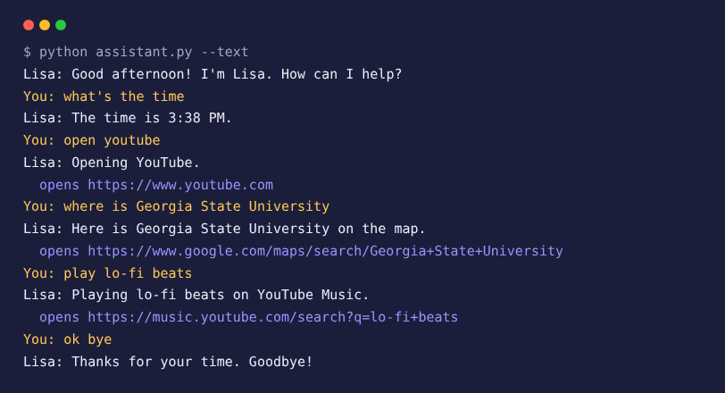

# Voice Assistant

Lisa is a voice assistant that listens for spoken commands and answers out loud: open websites, search Wikipedia, find places on a map, check the weather, play music, tell the time or tell a joke. It runs on Windows, macOS and Linux, and has a typing mode for when there's no microphone.




## Features

| Say | Lisa |
|---|---|
| "What's the time?" / "What's the date?" | Tells you |
| "Open YouTube" (also Google, Gmail, GitHub, LinkedIn, Maps) | Opens the site |
| "Who is Ada Lovelace?" / "Search Wikipedia for Alan Turing" | Reads a two-sentence summary |
| "Where is Georgia State University?" | Opens it on Google Maps |
| "What's the weather in Seattle?" | Reads current conditions |
| "Play lo-fi beats" | Opens it on YouTube Music |
| "Search for best pizza near me" | Opens Google results |
| "Tell me a joke" | Tells a programming joke |
| "Ok bye" | Says goodbye and stops |

## How it works

```
 microphone ─► SpeechRecognition (Google) ─┐
 keyboard (--text) ────────────────────────┤
                                           ▼
                     commands.parse()  "where is Atlanta" → Intent("locate", "Atlanta")
                                           ▼
                     commands.respond() → Response(say=..., open_url=...)
                                           ▼
              pyttsx3 speaks the reply   ·   browser opens the URL
```

`commands.py` holds all the understanding and decision logic with no audio or browser code. Each command is a regular-expression rule, checked in order so specific commands ("what is the time") win over general questions ("what is X"). The clock, Wikipedia, jokes and weather are passed in as functions, which keeps the logic fast to test.

## Run it

```bash
git clone https://github.com/ramya036/voice-assistant.git
cd voice-assistant
pip install -r requirements.txt

python assistant.py          # talk to Lisa
python assistant.py --text   # type commands instead
python assistant.py --mute   # print replies instead of speaking them
```

Speech recognition, Wikipedia and weather need an internet connection. On macOS or Linux, PyAudio may need `brew install portaudio` or `sudo apt install portaudio19-dev` first, and Linux text-to-speech uses `espeak` (`sudo apt install espeak`).

## Tests

```bash
pip install -r requirements-dev.txt
pytest
```

25 tests cover how each phrase is understood, rule priority, replies for every command, time-of-day greetings, safe URL building, and graceful failures when Wikipedia or the weather service is unreachable. GitHub Actions runs them on Windows, macOS and Linux.

## Project structure

| File | Description |
|---|---|
| `commands.py` | Understands commands and builds replies, with no audio or browser code |
| `assistant.py` | Microphone, speech output, browser and the main loop |
| `tests/` | pytest suite |
| `docs/demo.png` | Example session |
